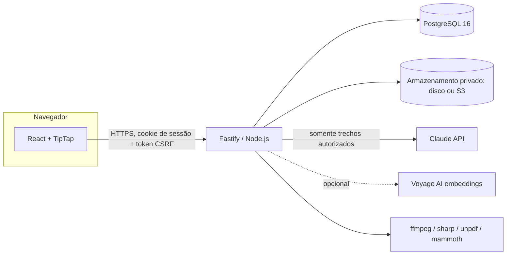

# Arquitetura, plano técnico e modelo de dados

## 1. Análise do projeto existente (Etapa 1)

O repositório estava **vazio** (sem commits, código, banco ou integrações). Não havia
tecnologias a preservar, então a arquitetura foi definida do zero, priorizando
ferramentas gratuitas e de código aberto, com dependências externas pagas apenas onde
inevitável (IA generativa) e sempre opcionais.

A imagem de referência para os vídeos mencionada na solicitação **não foi recebida**
nesta sessão. O comportamento foi implementado conforme a descrição textual (miniatura
incorporada ao conteúdo com botão de reprodução, player ampliado em modal mantendo a
proporção 16:9, fechamento para continuar a leitura). Ajustes visuais podem ser feitos
em `web/src/styles/content.css` (`.video-thumb`, `.video-modal`).

## 2. Visão geral

- **Um único serviço** (API + interface compilada) facilita a implantação; o frontend
  também pode ser servido por CDN.
- **Toda autorização ocorre no backend** (`server/src/auth/policies.ts`); a interface
  apenas oculta ações por conveniência.
- **PostgreSQL** concentra dados, pesquisa textual, bloqueios atômicos e auditoria.
  Arquivos ficam fora do banco, em armazenamento privado.
- **Tarefas periódicas** (`server/src/jobs.ts`): expiração de bloqueios, sessões,
  embeddings pendentes, retenção de conversas e retomada de documentos pendentes.

## 3. Módulos

| Módulo | Arquivos principais | Responsabilidade |
|---|---|---|
| Autenticação | `auth/plugin.ts`, `modules/auth.routes.ts` | Sessão em cookie `httpOnly`, CSRF, bloqueio após 5 tentativas |
| Autorização | `auth/context.ts`, `auth/policies.ts` | Permissões efetivas e políticas por recurso |
| Artigos | `modules/articles/*` | CRUD, sanitização, versões, histórico, publicação, indexação |
| Bloqueio | `modules/articles/locks.ts` | Lease atômico, renovação, liberação, expiração, liberação administrativa |
| Pesquisa | `modules/articles/search.ts` | FTS em português sem acentos, prefixos, sinônimos, trigramas, semântica |
| Arquivos | `modules/files.routes.ts`, `lib/uploads.ts`, `lib/storage.ts` | Validação por assinatura, miniaturas, streaming com Range, URLs assinadas |
| Tickets | `modules/tickets/*` | Abertura, mensagens, observações internas, status, reabertura, atendimento |
| IA | `modules/ai/*` | Recuperação autorizada, respostas estruturadas, auxílio na descrição |
| Documentos | `modules/documents/*` | Upload, extração, revisão/aprovação, indexação, rastreabilidade |
| Comunicados | `modules/announcements.routes.ts` | Cadastro, publicação, filtros |
| Administração | `modules/users.routes.ts`, `taxonomy.routes.ts`, `audit.routes.ts` | Usuários, perfis, permissões, empresas, taxonomia, auditoria |

## 4. Modelo de dados

Migration: `server/src/db/migrations/001_initial_schema.sql` (aplicada por
`npm run migrate`; controle em `schema_migrations`, com *advisory lock* para evitar
execução concorrente por várias instâncias).

```mermaid
erDiagram
  companies ||--o{ users : possui
  users ||--o{ user_roles : tem
  roles ||--o{ user_roles : ""
  roles ||--o{ role_permissions : ""
  permissions ||--o{ role_permissions : ""
  users ||--o{ user_permissions : "concessões/revogações"
  users ||--o{ sessions : ""
  categories ||--o{ articles : ""
  systems ||--o{ articles : ""
  users ||--o{ articles : autor
  articles ||--o{ article_tags : ""
  tags ||--o{ article_tags : ""
  articles ||--o{ article_versions : "snapshot imutável"
  articles ||--o{ article_history : "auditoria imutável"
  articles ||--o| article_locks : "no máximo 1"
  articles ||--o{ content_chunks : "trechos indexados"
  documents ||--o{ content_chunks : ""
  files ||--o| documents : original
  documents ||--o{ document_articles : ""
  articles ||--o{ document_articles : ""
  tickets ||--o{ ticket_messages : "públicas (imutáveis)"
  tickets ||--o{ ticket_internal_notes : "internas (imutáveis)"
  tickets ||--o{ ticket_events : "movimentações (imutáveis)"
  tickets ||--o{ ticket_attachments : ""
  files ||--o{ ticket_attachments : ""
  tickets ||--o{ ticket_articles : ""
  ai_conversations ||--o{ ai_messages : ""
  ai_messages ||--o{ ai_message_sources : "fontes"
  announcements ||--o{ announcement_articles : ""
  users ||--o{ audit_logs : "responsável"
```

Pontos relevantes:

- **Timestamps** em `timestamptz` gerados pelo banco (`now()`), conexão em UTC; a
  interface apresenta no fuso `APP_TIMEZONE`.
- **Imutabilidade**: `article_history`, `article_versions`, `audit_logs`,
  `ticket_messages`, `ticket_internal_notes` e `ticket_events` têm *trigger* que
  rejeita `UPDATE`/`DELETE`.
- **Restrições de integridade**: chaves estrangeiras com `RESTRICT` para preservar o
  histórico; `CHECK` de status/visibilidade; artigo publicado obrigatoriamente com
  categoria, sistema, resumo, conteúdo e responsável pela publicação.
- **Índices**: GIN para pesquisa (`search_vector`), trigramas para títulos, índices por
  status/visibilidade, solicitante, empresa, responsável e datas.
- **Duplicidade de documentos**: índice único por SHA-256 entre documentos não removidos.
- **Observações internas** em tabela separada de `ticket_messages`; anexos de observações
  têm proprietário próprio (`ticket_note`).

## 5. Fluxos críticos

### 5.1 Bloqueio de edição (lease)

1. `POST /api/articles/:id/lock` executa um único comando atômico:
   `INSERT … ON CONFLICT (article_id) DO UPDATE … WHERE article_locks.expires_at <= now()`.
   `article_id` é chave primária: só existe um bloqueio por artigo. Com sessões
   concorrentes, o PostgreSQL serializa a operação na mesma linha e somente uma recebe o
   registro (testado com 8 aquisições simultâneas).
2. O detentor recebe um `lock_token` secreto e renova o lease a cada
   `LOCK_HEARTBEAT_SECONDS` (padrão 30 s; validade `LOCK_TTL_SECONDS`, 120 s). Cada
   renovação revalida a permissão de edição.
3. Os demais usuários veem o botão “Editar artigo” desabilitado e a mensagem com nome,
   data e hora reais (atualização a cada 8 s).
4. Liberação: salvar e concluir, cancelar, sair da tela (navegação interna), fechar a aba
   (`navigator.sendBeacon` com o token), logout, desativação do usuário ou expiração do
   lease (somente após `expires_at`, registrada na auditoria).
5. Salvamento: na mesma transação, `SELECT … FOR UPDATE` do bloqueio (token, usuário,
   validade), revalidação da autorização e **concorrência otimista** (`expectedVersion`).
   Qualquer divergência retorna `409` com o motivo e gera registro `save_rejected`.
6. Liberação administrativa (`locks.release`) exige motivo e registra administrador,
   detentor, artigo, data/hora e motivo. A sessão antiga perde o token e não salva.

### 5.2 Publicação

Rascunho → visualização (modal com o mesmo renderizador do artigo publicado) →
publicação somente com `articles.publish`, sem bloqueio de terceiros e com campos
obrigatórios validados no backend. Alterar um artigo já publicado exige a permissão de
publicação (as alterações entram no ar imediatamente).

### 5.3 Pesquisa

- Configuração `pt_unaccent` (stemmer português + `unaccent`).
- Pesos: título (A); palavras-chave, tags e resumo (B); categoria e sistema (C);
  conteúdo (D).
- Consulta “OU” com prefixos (variações como exportar/exportação) e sinônimos
  cadastrados; bônus quando todos os termos aparecem; similaridade de trigramas para
  erros de digitação; destaque via `ts_headline` com marcadores renderizados com escape.
- Sugestões “Você quis dizer” calculadas **somente** sobre artigos visíveis ao usuário.
- Complemento semântico com embeddings quando `VOYAGE_API_KEY` estiver configurada.

### 5.4 Chat com IA

1. O backend define o público (interno ou externo) a partir das permissões.
2. Recupera trechos com filtro duplo: metadados do trecho **e** estado atual da fonte
   (artigo publicado / documento aprovado e não removido) com visibilidade permitida.
3. Sem trechos relevantes → mensagem padrão e oferta de ticket, **sem chamar o modelo**.
4. Com trechos → Claude recebe somente esses trechos, marcados como dados (não
   instruções), e responde em JSON estruturado (`found_solution`, `answer`, `steps`,
   `source_ids`).
5. O backend aceita apenas IDs de fontes realmente enviadas, monta os links das fontes
   e remove URLs do texto gerado.
6. Sem `ANTHROPIC_API_KEY`, o chat opera em **modo de consulta**, exibindo apenas os
   trechos encontrados (identificado na interface).

### 5.5 Documentos

Upload → validação (assinatura real, tamanho, duplicidade) → armazenamento privado →
fila de processamento → extração → prévia → revisão. O conteúdo só fica disponível para
pesquisa/IA após **aprovação**. Tornar externo um documento aprovado exige nova revisão.
Reprocessar também volta para revisão.

## 6. Plano de execução (etapas)

| Etapa | Situação |
|---|---|
| 1. Análise | Concluída (repositório vazio) |
| 2. Planejamento | Este documento |
| 3. Estrutura principal (ambientes, autenticação, pesquisa, artigos) | Implementada e testada |
| 4. Editor (formatação, alertas, imagens, GIFs, vídeos, pré-visualização) | Implementado e testado |
| 5. Auditoria e concorrência | Implementadas e testadas |
| 6. Suporte (tickets) | Implementado e testado |
| 7. IA | Implementada; testada com provedor simulado (sem chave real nesta sessão) |
| 8. Documentos | Implementado e testado (PDF/DOCX); DOC depende do LibreOffice |
| 9. Segurança e testes | 119 testes de backend, 5 de frontend, 8 ponta a ponta |
| 10. Entrega | Documentação e relatório em `docs/` |
